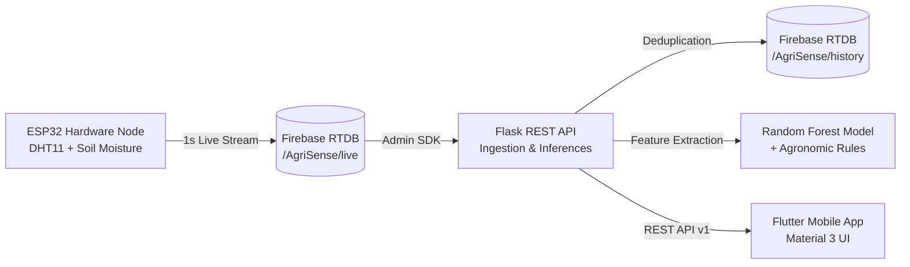

# AgriSense — Complete IoT Smart Agriculture Platform

AgriSense is an end-to-end, production-oriented IoT smart agriculture platform featuring an ESP32 hardware edge node, Firebase Realtime Database integration via Firebase Admin SDK, a Python Flask REST API with a machine learning irrigation intelligence pipeline, and a modern cross-platform Flutter mobile application.

---

## 1. System Architecture



---

## 2. Key Features

- **Real-Time Telemetry:** Continuous reading of temperature, relative humidity, raw 12-bit soil moisture ADC, and calibrated volumetric estimates from Firebase Realtime Database.
- **Sensor Data Quality & Health:** Dedicated validation layer detecting stale device broadcasts, sensor read faults, out-of-range ADC values, and physical boundary violations.
- **Deduplicated History Ingestion:** Automated backend ingestion that watches device progression (`uptime_ms`), filters duplicates, and writes timestamped records to `/AgriSense/history`.
- **Machine Learning Pipeline:** Trained `RandomForestClassifier` predicting crop irrigation need based on soil moisture, ambient temperature, relative humidity, Vapor Pressure Deficit (VPD), crop sensitivity, and soil type.
- **Transparent Fallback Rule Engine:** Gracefully falls back to FAO-56 agronomic thresholds when the ML model is unavailable or telemetry fails validation.
- **Operational Alerts Engine:** Real-time generation of `CRITICAL`, `WARNING`, `INFO`, and `ERROR` alerts for water stress, extreme heat, chill, and hardware faults.
- **Modern Flutter UI (Material 3):**
  - **Home Dashboard:** Live gauges, connectivity status, metric cards, recommendation banner, and 24h trends.
  - **Sensor Analytics:** Interactive time-series charts (`fl_chart`) for moisture, temperature, and humidity across 6h, 24h, and 7d windows.
  - **AI Insights:** Full agronomic factor breakdown, confidence score, and on-demand inference triggers.
  - **Active Alerts:** Categorized alert cards with sensor trigger values.
  - **Settings:** Dynamic API host configuration with one-tap presets (Emulator, Localhost, LAN IP), connection tester, crop/soil selectors, and custom threshold tuning.

---

## 3. Hardware Connections

| Sensor | Sensor Pin | ESP32 GPIO Pin | Function |
| :--- | :--- | :--- | :--- |
| **DHT11** | VCC | 3.3V / 5V | Power supply |
| **DHT11** | GND | GND | Ground |
| **DHT11** | DATA | **GPIO 27** | Digital Temperature & Humidity |
| **Soil Moisture** | VCC | 3.3V | Power supply |
| **Soil Moisture** | GND | GND | Ground |
| **Soil Moisture** | AO (Analog) | **GPIO 35** | 12-bit ADC Reading (0–4095) |
| **Soil Moisture** | DO (Digital) | **GPIO 34** | Digital Dry/Wet Comparator Threshold |

*Note: Raw ADC reading (0–4095) is inversely proportional to soil water content (4095 = completely dry air, ~1400 = water saturated). AgriSense distinguishes between raw ADC and calibrated estimates.*

---

## 4. Technology Stack

### Backend
- **Language:** Python 3.14 / 3.15
- **Web Framework:** Flask 3.1, Flask-CORS 6.0
- **Cloud Database:** Firebase Realtime Database via `firebase-admin 7.7.0`
- **Machine Learning:** `scikit-learn 1.9.1`, `pandas 3.1.0`, `numpy 2.5.4`, `joblib 1.6.0`
- **Testing:** `pytest 9.1.1`
- **WSGI / Production:** `gunicorn 26.2.0`

### Mobile App
- **Framework:** Flutter 3.x / Dart 3.x
- **State Management:** `provider 6.1.5`
- **Networking:** `dio 5.11.1`
- **Charts:** `fl_chart 0.70.2`
- **Typography:** `google_fonts 6.3.3`
- **Persistence:** `shared_preferences 2.5.6`
- **Formatting:** `intl 0.20.3`

---

## 5. Project Directory Structure

```
AgriSense/
├── app/ -> symlink to agrisense/
├── agrisense/                    # Flutter Mobile Application
│   ├── lib/
│   │   ├── main.dart             # App Entry Point
│   │   ├── app.dart              # MultiProvider & Navigation Shell
│   │   ├── core/
│   │   │   ├── config/           # Platform Host & Timeout Configuration
│   │   │   ├── theme/            # Theme, Colors & Typography
│   │   │   └── errors/           # Custom Typed App Exceptions
│   │   ├── models/               # Typed Models (SensorReading, DashboardData, etc.)
│   │   ├── services/             # ApiClient (Dio) & PreferencesService
│   │   ├── providers/            # SensorProvider & SettingsProvider
│   │   ├── features/
│   │   │   ├── dashboard/        # Dashboard Screen & Reusable Metric Widgets
│   │   │   ├── analytics/        # Analytics Screen & fl_chart Cards
│   │   │   ├── ai_insights/      # AI Insights & Decision Breakdown Screen
│   │   │   ├── alerts/           # Active Alerts Screen
│   │   │   └── settings/         # Settings & Host Config Screen
│   │   └── shared/widgets/       # Loading, Empty, and Error Views
│   ├── test/                     # Unit & Widget Tests
│   └── pubspec.yaml
│
├── backend/                      # Python Flask Backend & ML Engine
│   ├── app.py                    # Flask Application Factory & WSGI Entry
│   ├── config.py                 # Environment Configuration & Secret Resolution
│   ├── requirements.txt          # Python Dependencies
│   ├── .env.example              # Configuration Template (No secrets)
│   ├── .env                      # Local Configuration (Git-ignored)
│   ├── routes/                   # API Route Blueprints
│   │   ├── health.py             # GET /api/v1/health
│   │   ├── dashboard.py          # GET /api/v1/dashboard
│   │   ├── sensors.py            # GET /api/v1/sensors/latest & history
│   │   ├── predictions.py        # GET /api/v1/predictions/latest & POST run
│   │   ├── alerts.py             # GET /api/v1/alerts
│   │   └── settings.py           # GET & POST /api/v1/config
│   ├── services/                 # Business Logic Services
│   │   ├── firebase_service.py   # Firebase Admin RTDB Client
│   │   ├── sensor_service.py     # Data Validation & Staleness Tracking
│   │   ├── history_service.py    # Deduplication & Bounded Queries
│   │   ├── recommendation_service.py # ML & Rule Fallback Engine
│   │   └── alert_service.py      # Real-time Alert Evaluator
│   ├── ml/                       # Machine Learning Pipeline
│   │   ├── features.py           # Feature Engineering & VPD Calculator
│   │   ├── train.py              # FAO-56 Agronomic Dataset Training
│   │   ├── predict.py            # Model Inference & Explainability
│   │   ├── evaluate.py           # Independent Model Evaluator
│   │   └── models/               # Saved Artifacts (.joblib & metadata.json)
│   ├── scripts/
│   │   ├── simulate_esp32_stream.py # Standalone ESP32 Live Stream Simulator
│   │   └── migrate_sensor_history.py# History Migration & Inspection
│   └── tests/                    # Backend Pytest Test Suite
│
├── docs/                         # Detailed Technical Documentation
│   ├── architecture.md           # System Architecture & Diagrams
│   ├── api.md                    # REST API Reference
│   ├── firebase_setup.md         # Firebase Realtime DB Setup & Rules
│   └── ml_methodology.md         # ML Training, Features & Metrics
│
├── .gitignore                    # Secrets, Venv, and Build Protections
└── README.md
```

---

## 6. Quick Start & Execution Guide

### Step 1: Backend Setup & Launch

1. **Navigate to the backend directory and create a virtual environment:**
   ```bash
   cd /Users/yash/Desktop/AgriSense
   python3 -m venv backend/venv
   source backend/venv/bin/activate
   ```

2. **Install dependencies:**
   ```bash
   pip install -r backend/requirements.txt
   ```

3. **Configure Environment Variables:**
   Create `backend/.env` from `.env.example`:
   ```bash
   cp backend/.env.example backend/.env
   ```
   Ensure `FIREBASE_SERVICE_ACCOUNT` points to your service account key file.

4. **Train and evaluate the ML Model:**
   ```bash
   python backend/ml/train.py
   ```
   *This trains the Random Forest classifier and outputs `backend/ml/models/irrigation_model.joblib`.*

5. **Start the Flask Development API Server:**
   ```bash
   python backend/app.py
   ```
   The API will bind to `http://0.0.0.0:5001`. Test health check:
   ```bash
   curl http://127.0.0.1:5001/api/v1/health
   ```

---

### Step 2: Flutter Mobile App Launch

1. **Navigate to the Flutter project:**
   ```bash
   cd /Users/yash/Desktop/AgriSense/agrisense
   ```

2. **Fetch dependencies:**
   ```bash
   flutter pub get
   ```

3. **Run Static Analysis and Tests:**
   ```bash
   flutter analyze
   flutter test
   ```

4. **Run the App on your target platform:**
   - **macOS Desktop:**
     ```bash
     flutter run -d macos
     ```
   - **Chrome Web:**
     ```bash
     flutter run -d chrome
     ```
   - **Android Emulator:**
     ```bash
     flutter run -d emulator
     ```
     *(The app automatically detects Android and connects to `http://10.0.2.2:5001/api/v1`)*
   - **iOS Simulator:**
     ```bash
     flutter run -d iPhone
     ```
   - **Physical Device:**
     Connect your phone to the same Wi-Fi network as your computer, navigate to the **Settings** tab in the app, and set the API Base URL to `http://<YOUR_COMPUTER_LAN_IP>:5001/api/v1`. Tap **Test Backend Connection**.

---

## 7. Running Automated Tests

### Backend Test Suite (Pytest)
```bash
cd /Users/yash/Desktop/AgriSense
PYTHONPATH=. backend/venv/bin/pytest backend/tests/
```
*Executes all 22 test cases covering Firebase service mocking, sensor validation, staleness calculations, deduplication, ML inference, fallback rules, and all REST endpoints.*

### Flutter Test Suite
```bash
cd /Users/yash/Desktop/AgriSense/agrisense
flutter test
```
*Executes all 13 widget and model serialization test cases.*

---

## 8. Standalone ESP32 Live Stream Simulator

If you do not have the physical ESP32 powered on, you can run the live simulator script to stream continuous realistic telemetry to Firebase:
```bash
python backend/scripts/simulate_esp32_stream.py
```
This streams realistic temperature, humidity, and soil moisture variations to `/AgriSense/live` in real-time, allowing full verification of live gauge animations, chart refreshes, and alert triggers.

---

## 9. Production Deployment

### Backend Production WSGI (Gunicorn)
In production, do not use the Flask development server. Run with Gunicorn:
```bash
cd /Users/yash/Desktop/AgriSense
backend/venv/bin/gunicorn --bind 0.0.0.0:5001 --workers 4 --timeout 60 "backend.app:app"
```

### Security & Secret Isolation
1. **Service Account Protection:** `backend/agrisense-ed6c9-firebase-adminsdk-*.json` and `backend/.env` are strictly excluded in `.gitignore`.
2. **Client Isolation:** The Flutter app connects strictly via the Flask REST API. The Firebase Admin private key is **never** bundled into the mobile client.
3. **HTTPS / TLS:** Always place the Flask backend behind a reverse proxy (e.g. Nginx, Cloud Run, or AWS ECS) with a valid SSL certificate in production.
