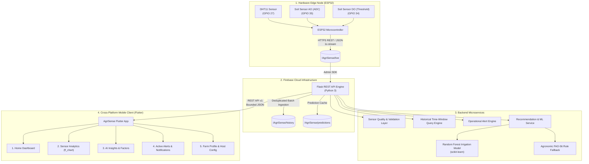

# AgriSense Architecture Documentation

## 1. System Overview
AgriSense is a production-grade IoT smart agriculture platform designed to provide precision soil monitoring, microclimate tracking, and machine-learning-driven irrigation intelligence.

---

## 2. Component Design

### 2.1 Edge IoT Layer
- **Microcontroller:** ESP32 Dev Module.
- **Microclimate:** DHT11 sensor measuring Temperature (0–50°C, ±2°C) and Relative Humidity (20–90% RH, ±5%). Connected to GPIO 27.
- **Soil Moisture:** Capacitive/resistive soil sensor with:
  - Analog output (AO) connected to GPIO 35 (12-bit ADC: 0 to 4095).
  - Digital output (DO) connected to GPIO 34 (threshold comparator).
- **Network Protocol:** WiFi 802.11 b/g/n broadcasting JSON telemetry to Firebase Realtime Database.

### 2.2 Data Quality & Health Layer (`SensorService`)
To protect against sensor failure, loose wiring, or stale telemetry:
1. **Physical Plausibility Bounds:** Implausible readings (e.g. DHT11 > 60°C or negative humidity) are detected and flagged.
2. **ADC Normalization:** The 12-bit ADC value (0–4095) is preserved as raw data and separately calibrated into a percentage estimate ($0\%$ at air $4095$, $100\%$ at saturation $\le 1400$).
3. **Staleness Tracking:** Tracks device `uptime_ms` progression and observation intervals against a configurable timeout (default 60s).

### 2.3 History Deduplication & Ingestion (`HistoryService`)
- Overcomes the firmware limitation of overwriting only `/AgriSense/live`.
- Ingestion checks for genuine device progression (`uptime_ms` delta) and enforces a 2-second rate limit.
- Timestamped records are written to `/AgriSense/history/<timestamp_ms>`.
- Provides time-bounded range querying with minimum, maximum, and average statistics.

### 2.4 ML & Agronomic Recommendation Layer (`RecommendationService`)
- Integrates a trained `RandomForestClassifier` scoring soil moisture deficit, atmospheric drying power (Vapor Pressure Deficit, VPD), ambient temperature, crop sensitivity, and soil retention characteristics.
- If the model is not trained or telemetry fails validation, it falls back transparently to configurable agronomic rules (FAO-56 guidelines), clearly distinguished in the UI.

### 2.5 Mobile Presentation Layer (`Flutter`)
- Built with Dart 3 & Flutter Material 3.
- State management with `Provider` and dynamic host resolution.
- Responsive, accessible layouts with customized chart rendering (`fl_chart`).
